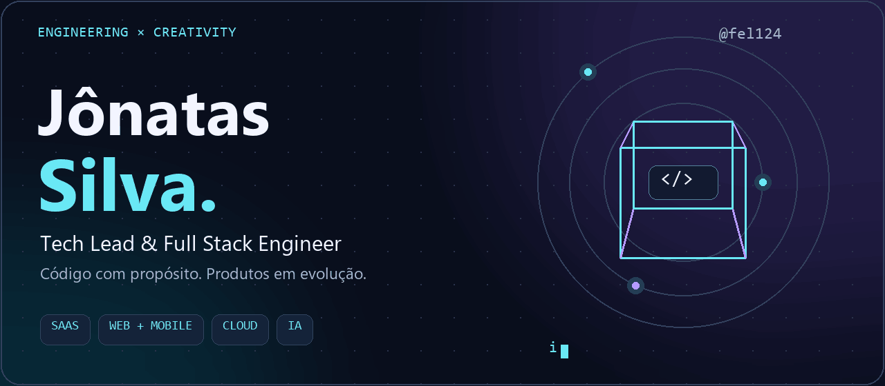
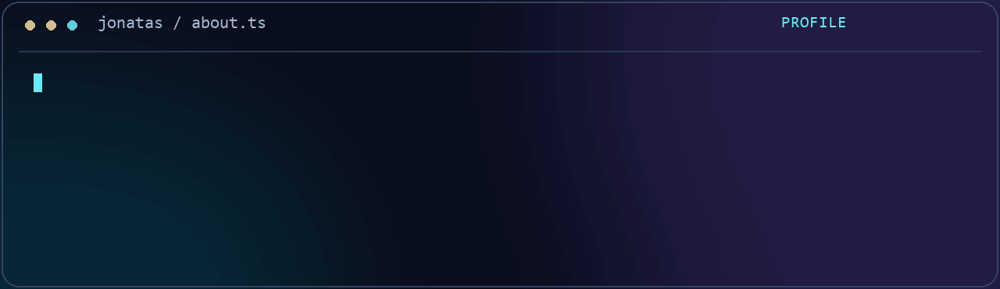
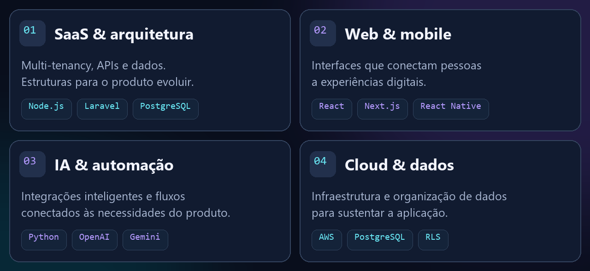
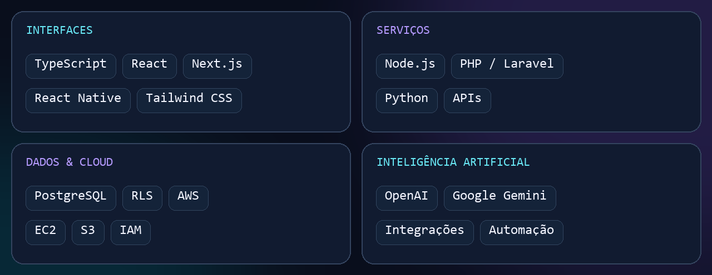
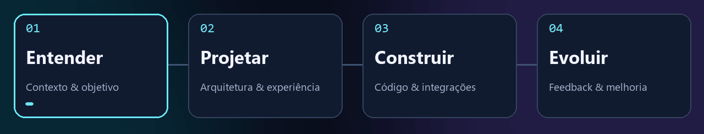
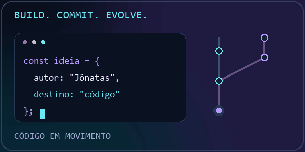
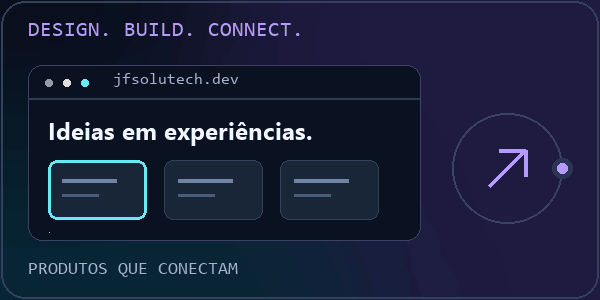

  

<h3 align="center">Arquitetura que sustenta. Interfaces que conectam. IA que agrega.</h3>

Do primeiro conceito à evolução do produto, construindo experiências digitais de ponta a ponta.

  
  
  

  <a href="#01--por-trás-do-código">Sobre mim</a> ·
  <a href="#02--o-que-construo">Especialidades</a> ·
  <a href="#03--meu-ecossistema">Tecnologias</a> ·
  <a href="#05--explore-meu-trabalho">Projetos</a>

## 01 · Por trás do código

Sou **Jônatas Silva**, Tech Lead e desenvolvedor Full Stack. Conecto **engenharia, experiência do usuário e necessidades de negócio** para transformar ideias em produtos digitais.

Meu foco está em **SaaS multi-tenant**, aplicações **web e mobile** e **integrações de inteligência artificial** — da interface às APIs, dos dados à nuvem.

> **Meu norte:** código com propósito, clareza na experiência e espaço para o produto evoluir.

## 02 · O que construo

<strong>🔎 Conheça o foco de cada especialidade</strong>

- **SaaS & arquitetura:** multi-tenancy, APIs e organização de dados para a evolução do produto.
- **Web & mobile:** interfaces com React e Next.js e aplicativos com React Native.
- **IA & automação:** integrações com OpenAI e Gemini e fluxos conectados às necessidades do produto.
- **Cloud & dados:** infraestrutura AWS, PostgreSQL e Row Level Security (RLS).

## 03 · Meu ecossistema

  
  
  
  
  
  
  

<strong>🧩 Ver a stack completa em texto</strong>

| Camada | Tecnologias e práticas |
| :--- | :--- |
| **Frontend & mobile** | TypeScript, JavaScript, React, Next.js, React Native e Tailwind CSS |
| **Backend** | Node.js, PHP / Laravel e Python |
| **Dados & arquitetura** | PostgreSQL, Row Level Security (RLS) e multi-tenancy |
| **Cloud** | AWS EC2, S3 e IAM |
| **Inteligência artificial** | Integrações com OpenAI e Google Gemini |

## 04 · Da ideia à evolução

**Entender o problema → projetar a solução → construir com propósito → evoluir com feedback.**

## 05 · Explore meu trabalho

<table>
<tr>
<td width="50%" valign="top">
<h3>⌘ Código & estudos</h3>

Meu espaço pessoal para compartilhar código e acompanhar a evolução do meu trabalho.

<a href="https://github.com/fel124?tab=repositories&amp;type=public"><strong>Explorar repositórios públicos →</strong></a>
</td>
<td width="50%" valign="top">
<h3>↗ Portfólio & conexões</h3>

Conheça meu portfólio e converse comigo sobre software, arquitetura e produtos digitais.

<a href="https://jfsolutech.dev"><strong>Conhecer meu portfólio →</strong></a>
</td>
</tr>
</table>

Projetos, estudos e apresentação profissional de <strong>Jônatas Silva · @fel124</strong>.

 

  <a href="https://www.linkedin.com/in/jonatas-felipe-silva-0a86b5bb/"><strong>Vamos conversar no LinkedIn</strong></a> ·
  <a href="mailto:jonatas@jfsolutech.dev"><strong>Enviar um e-mail</strong></a>

Jônatas Silva · Ideias em código. Produtos em evolução.

