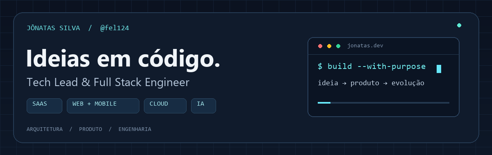

  

<h1 align="center">Olá, eu sou o Jônatas Silva.</h1>

<strong>Arquitetura de software · Desenvolvimento Full Stack · IA aplicada a produtos</strong>

Transformo ideias em produtos digitais, conectando experiência do usuário, engenharia de software e necessidades reais de negócio.

  
  
  

---

## Sobre mim

Sou **Jônatas Silva**, Tech Lead e desenvolvedor Full Stack. Meu foco está na construção de **plataformas SaaS multi-tenant**, aplicações web e mobile e integrações de inteligência artificial.

Trabalho de ponta a ponta: da interface e das APIs à modelagem de dados e à infraestrutura em nuvem. Busco unir uma experiência de uso clara a uma arquitetura que permita ao produto evoluir.

- **Produto:** transformar necessidades de negócio em funcionalidades úteis.
- **Engenharia:** organizar interfaces, serviços e dados para facilitar a evolução do software.
- **Integrações:** conectar sistemas, automatizar fluxos e aplicar IA com propósito.

## O que construo

| SaaS & plataformas | Web & mobile | Automação & IA |
| :--- | :--- | :--- |
| Arquiteturas multi-tenant, APIs e organização de dados. | Interfaces com React e Next.js e aplicativos com React Native. | Integrações com OpenAI e Gemini para ampliar as capacidades dos produtos. |
| **Node.js · Laravel · PostgreSQL** | **TypeScript · React · Tailwind CSS** | **Python · APIs · Cloud** |

## Minha stack

  
  
  
  
  
  
  
  

| Camada | Tecnologias e práticas |
| :--- | :--- |
| **Frontend & mobile** | React, Next.js, React Native, TypeScript, JavaScript e Tailwind CSS |
| **Backend** | Node.js, PHP / Laravel e Python |
| **Dados & arquitetura** | PostgreSQL, Row Level Security (RLS) e multi-tenancy |
| **Cloud** | AWS EC2, S3 e IAM |
| **Inteligência artificial** | Integrações com OpenAI e Google Gemini |

## Projetos de Jônatas Silva

Este é meu espaço pessoal para compartilhar código, estudos e a evolução do meu trabalho em engenharia de software.

**[Explorar meus repositórios públicos →](https://github.com/fel124?tab=repositories&type=public)**  
**[Conhecer meu portfólio →](https://jfsolutech.dev)**

---

<h3 align="center">Vamos transformar uma ideia em produto?</h3>

Converse comigo sobre desenvolvimento Full Stack, arquitetura SaaS e integrações de IA.

<a href="https://www.linkedin.com/in/jonatas-felipe-silva-0a86b5bb/">LinkedIn</a> · <a href="https://jfsolutech.dev">Portfólio</a> · <a href="mailto:jonatas@jfsolutech.dev">E-mail</a>

Jônatas Silva · @fel124 · Ideias em código, produtos em evolução.

